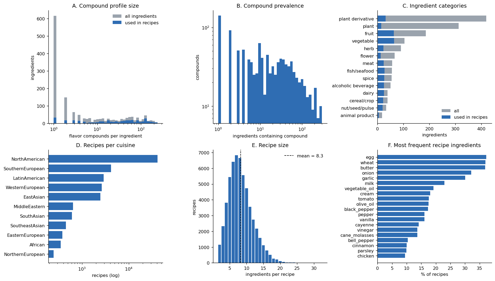
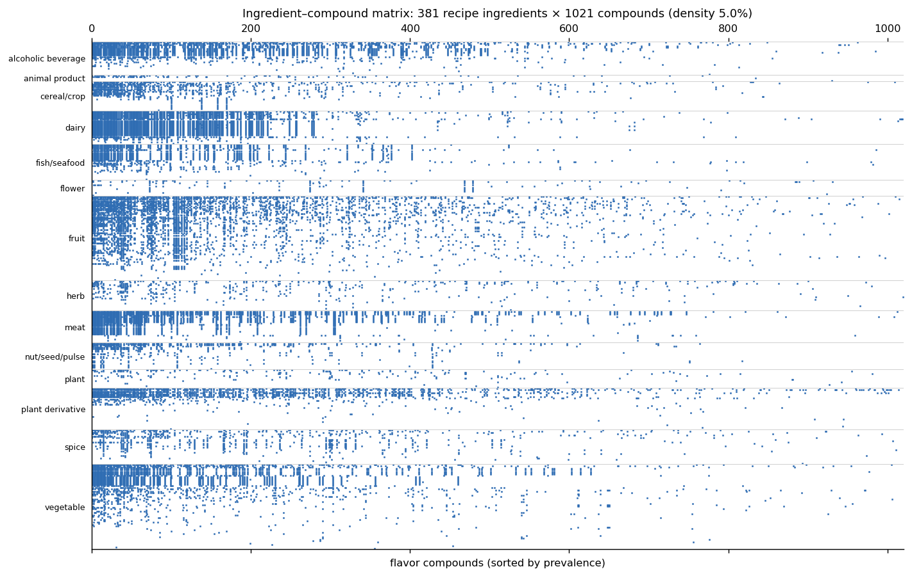
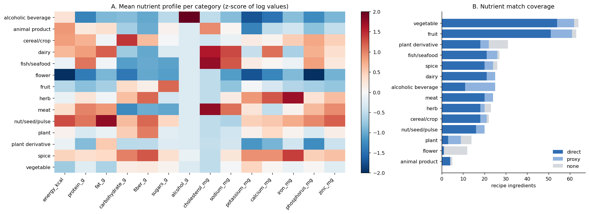

# Deliverable 1: Data Pipeline & Ingredient–Compound Matrix

This deliverable builds two ingredient matrices for the same 381 recipe ingredients:
- **Part A:** ingredient × flavor-compound matrix (§1–5). Used by flavor-based substitution.
- **Part B:** ingredient × nutrient matrix from FooDB (§6). Used by nutrient-based substitution.

**Code:**
- `src/d1_data_pipeline.py` (Part A, about 5 s)
- `src/foodb_extract.py`: one-off streaming of FooDB, about 20 s
- `src/d1_nutrient_pipeline.py` (Part B)

Run them in that order. All three are deterministic.

**Outputs:** `data/processed/`, `data/mappings/`, `results/d1/`

## 1. Data source

We use the *Flavor Network* dataset from Ahn et al., "Flavor network and the principles of food pairing", *Scientific Reports* 1:196 (2011). It is a standard benchmark in computational gastronomy. It is a good fit for this project because it holds **both** pieces of data the project needs, and their ingredient names already match:

| File | Content | Size |
|---|---|---|
| `ingr_info.tsv` | ingredient id, name, category (14 categories) | 1,530 ingredients |
| `comp_info.tsv` | flavor compound id, name, CAS number | 1,107 compounds |
| `ingr_comp.tsv` | ingredient → compound links (from Fenaroli's handbook / Burdock 2004) | 36,781 links |
| `srep00196-s3.csv` | recipes (Allrecipes, Epicurious, Menupan): cuisine + ingredient list | 56,498 recipes, 11 cuisines |
| `srep00196-s2.csv` | the paper's published shared-compound counts per ingredient pair | 221,777 pairs (used **only** to verify the data) |

The recipe file (s3) and the verification file (s2) were downloaded from the paper's official Nature supplementary material. The three raw `.tsv` flavor tables are not hosted by Nature, so they were taken from a public GitHub mirror of the original release. Their faithfulness was checked (see §3).

## 2. Pipeline steps

1. **Load and clean the flavor tables.** Names are normalised (lowercase, underscores). The script then checks for duplicate links, duplicate names, and links that point to missing ingredient or compound ids. *Result:* none of these problems occurred. **5 ingredients have no compounds** (e.g. `bitter_almond_oil`, `sesame_seed_oil`) and were dropped, because they carry no chemical information.
2. **Integrity check.** For all 221,777 ingredient pairs in the paper's s2 file, the script recomputes |C_a ∩ C_b| from our tables. **The match rate is 100%**, so the mirrored tables are identical to what the authors used.
3. **Parse recipes.** Each line is split into a cuisine and a list of ingredients, and repeated ingredients within a recipe are removed (none found). **All 381 distinct recipe ingredients are present in the compound table**, so no fuzzy name matching was needed. **354 recipes with fewer than 2 ingredients were dropped**, because they contain no ingredient pairs to analyse. 56,144 recipes remain.
4. **Ingredient × compound matrix.** X ∈ {0,1}^(1525 × 1107), where X[i,c] = 1 if ingredient *i* contains compound *c*. Each row is the ingredient's *compound set* C_i, which is the input to the Jaccard similarity J(a,b) = |C_a ∩ C_b| / |C_a ∪ C_b| in D2.
5. **Recipe × ingredient matrix.** R ∈ {0,1}^(56144 × 1525). This is the input to the co-occurrence validation in D3.

## 3. Outputs

| File | Description |
|---|---|
| `data/processed/ingredient_compound_matrix.npz` | sparse X, 1,525 × 1,107. Rows are in the order of `ingredients.csv` (`row`), columns in the order of `compounds.csv` (`col`) |
| `data/processed/ingredient_compound_matrix_recipe_ingredients.csv` | dense, readable **subset**: only the 381 ingredients that appear in recipes (`in_recipes == True` in `ingredients.csv`) × the 1,021 compounds they contain. This is why it has 381 rows while `ingredients.csv` has 1,525. The pipeline asserts that this subset matches the full `.npz` matrix |
| `data/processed/recipe_ingredient_matrix.npz` | sparse R, 56,144 × 1,525 |
| `data/processed/ingredients.csv` | name, category, `n_compounds`, `recipe_freq`, `in_recipes` |
| `data/processed/compounds.csv` | name, CAS, `n_ingredients`, `n_recipe_ingredients` |
| `data/processed/recipes.csv` | recipe_id, cuisine, ingredients (`;`-separated), size |
| `results/d1/d1_summary.json` | every number quoted in this report |
| `results/d1/d1_eda_overview.png`, `d1_matrix_spy.png` | figures |

## 4. Exploratory analysis

| | All ingredients | Recipe ingredients |
|---|---|---|
| Ingredients | 1,525 | 381 |
| Compounds covered | 1,107 | 1,021 |
| Matrix density | 2.2% | 5.0% |
| Compounds / ingredient: median (mean) | 2 (24.1) | **32 (51.2)** |
| Compounds / ingredient: range | 1 – 239 | 1 – 239 |

Key observations:

- **Compound profiles are heavily skewed (panel A).** 616 of the 1,525 ingredients have exactly one known compound. Most of these are obscure plant derivatives and essential oils that never appear in recipes (panel C). The 381 recipe ingredients are far better characterised (median 32 compounds). However, **67 of them still have ≤ 3 compounds**. The richest profiles belong to heavily studied foods: black tea (239), coffee (234), beer (227), white wine (222), and roasted beef (216).
- **Compound prevalence is broad (panel B).** Some compounds appear in only one ingredient, while generic fermentation and lipid-oxidation volatiles are everywhere: 1-octanol (299 ingredients), n-nonanal (298), isobutyl alcohol (286), hexyl alcohol (283). A shared common compound says much less than a shared rare one. This is worth remembering when we interpret Jaccard scores.
- **Recipes are North-American-dominated (panel D).** 74% of recipes are North American, so later co-occurrence statistics will lean towards that cuisine. Recipes average **8.3 ingredients** (panel E). The most common ingredients are egg, wheat, and butter (each in about 37% of recipes), followed by onion and garlic (panel F).
- **The matrix has block structure (spy plot below).** Ingredients in the same category (dairy, meat, alcoholic beverages, fruit) share dense bands of compounds. This is early evidence that compound overlap reflects real culinary similarity.

### Implication for D2: identical compound profiles

Among the 381 recipe ingredients there are **10 groups (24 ingredients) with identical compound sets**, so their Jaccard similarity is 1.0:

| Profile size | Pairs | Plausible substitute? |
|---|---|---|
| 127 | emmental_cheese = munster_cheese | yes |
| 86 | bean = mung_bean | yes |
| 65 | catfish = haddock; eel = mackerel | yes |
| 4–5 | corn_flake = macaroni = rye_flour = …; beef_liver = chicken_liver | mixed |
| 1 | chickpea = octopus; carob = zucchini; bay = pimenta; balm = blackberry_brandy | **mostly spurious** |

When profiles are rich, chemical identity matches culinary intuition. When profiles are sparse, it produces nonsense. **D2 therefore attaches an uncertainty estimate to every flavor recommendation** (a bootstrap confidence interval and a High/Medium/Low label), so that sparse-data matches remain visible but are clearly marked. A hard cutoff would have removed 81 ingredients.

## 5. Limitations of the data

- **Incomplete compound coverage.** A missing link may mean "not measured", not "absent". Sparse profiles are therefore uncertain rather than truly simple.
- **Binary representation.** The matrix records whether a compound is present, not its concentration or odour threshold.
- **Recipe bias.** The recipe data covers 381 ingredients at a coarse level ("cheese", "pepper" and "black_pepper" are separate entries) and is 74% North American.

---

## 6. Part B: Nutrient data from FooDB

Nutrient-based substitution needs a nutrient profile per 100 g for each recipe ingredient. The source is **FooDB** (2020-04-07 JSON release, `foodb_2020_04_07_json/`), the largest open food-composition database.

### 6.1 Extraction

FooDB's `Content.json` is 3.5 GB (5.69 M rows). `src/foodb_extract.py` streams it once and keeps 408,225 rows: every row of FooDB's 39 "Nutrients", plus 31 nutritionally important *compounds*. Minerals, vitamins, sugars, water and cholesterol are stored as compounds in FooDB. The result is cached as `data/interim/foodb_nutrient_content.csv`.

### 6.2 Data-quality checks and the cleaning rules they led to

| Check | Finding | Rule adopted |
|---|---|---|
| Values for known foods | Butter energy was 2,109 "kcal", although the real value is 717 | FooDB's `standard_content` sometimes holds **kJ**, while `orig_content` always holds kcal. Energy is read from `orig_content`. |
| Sources | 77% of rows come from **USDA**, 20% from DTU (the Danish food database) | USDA is the primary source. |
| DTU vs USDA on the same foods (median log10 ratio) | protein, carbs, sugars, Na, K, Ca, Fe, P, Zn agree (about 0.0); **cholesterol is off by about 500×** (µg labelled as mg); energy mixes kJ and kcal; DTU's "Fatty acids" is not total fat | DTU is used only for the 5 foods that have no USDA record, and only for the nutrients that agree. Its "Fat" field is used for fat (median log ratio 0.02). Energy is computed from Atwater factors, and cholesterol is imputed. |
| Field meaning | USDA's "Fatty acids" row is *"Total lipid (fat)"* | That row is used as `fat_g`. |
| Missing nutrients | Vitamin C has data for only 5 foods; vitamin A uses mixed units (IU, RE, mg) | Both are excluded. |

### 6.3 Matching ingredients to foods

FooDB's 992 "food" entries are too coarse. "Chicken" mixes heart, gizzard and liver, and many entries have no USDA data at all. Automatic fuzzy name matching also failed (bacon → *Acorn*, salmon → *Almond*). Instead, each recipe ingredient was mapped by hand to **one specific USDA product description** stored in FooDB, preferring the plain raw form. The mapping is in **`data/mappings/ingredient_to_usda.csv`** and is fully auditable. Every row has a match type and, where needed, a note. The pipeline asserts that every description exists in FooDB.

| Match type | Ingredients | Example |
|---|---|---|
| direct | 276 (271 USDA, 5 DTU) | butter → *Butter, without salt*; oregano → *Spices, oregano, dried* |
| proxy | 68 | emmental → *Cheese, swiss*; prawn → *Crustaceans, shrimp*; cognac → *distilled spirit, 80 proof* |
| none | 37 | flowers (rose, lavender), essential oils (celery_oil), non-foods (wood, smoke), generic terms (fruit, leaf) |

The 14 nutrient features (per 100 g) are: energy, protein, fat, carbohydrate, fibre, sugars, alcohol, cholesterol, sodium, potassium, calcium, iron, phosphorus and zinc.

**Missing values.** Animal foods get 0 fibre, and meat, fish and eggs get 0 sugars; these are structural zeros. Alcohol is set to 0 outside beverages. Any other gap is filled with the category median. 2.4% of cells were missing in the raw data. After applying the structural zeros, only **1.7%** were filled with a category median, and these are mostly sugars. 49 ingredients have at least one imputed value, and 4 have more than two. The count of imputed cells is stored per ingredient (`n_imputed`) and feeds into the confidence labels in D2.

### 6.4 Result

**`data/processed/ingredient_nutrients.csv`**: **344 of 381** recipe ingredients (90%) have a nutrient profile. Together they cover **99.0% of all ingredient uses in recipes**.

The nutrient data complements the flavor data well. Several ingredients that flavor mode can barely score, because they have very few known compounds, have complete nutrient profiles: olive oil, vegetable oil, lemon juice, oregano, scallion and chicken broth.

**Sanity checks** (asserted in code or checked by hand):
- Macronutrients never exceed 105 g per 100 g, and energy never exceeds 905 kcal.
- Spot checks against the familiar USDA values pass: butter 717 kcal and 81 g fat; olive oil 884 kcal and 100 g fat; egg 143 kcal and 12.6 g protein; whiskey 250 kcal and 36 g alcohol.
- Energy and the Atwater estimate differ by a median of only 5.9 kcal. The larger gaps have known causes:
  - spices, cocoa and carob: USDA's carbohydrate figure includes fibre;
  - citrus: USDA uses food-specific energy factors;
  - vinegar: its energy comes from acetic acid.

The category profiles in panel A behave as expected: alcohol in beverages, cholesterol and sodium in animal foods, fat in nuts, iron in herbs and spices.

**Limitations of the nutrient data**
- A proxy match means some ingredients share a record and are therefore nutritionally identical in our data (for example all distilled spirits, or all brewed teas).
- Imputed cholesterol for organ meats (chicken liver: 72 mg imputed against about 345 mg real) underestimates the true value.
- Raw values are used, not the values as cooked.

### 6.5 Extended nutrient catalog: all FooDB foods with a nutrient profile

Nutrient substitution does not need flavor-compound or recipe data, so it is not limited to the recipe ingredients. **`data/processed/food_nutrient_catalog.csv`** contains **808 foods**:
- the 344 hand-matched recipe ingredients;
- **464 further FooDB foods** that have usable nutrient data (427 from USDA, 37 from DTU), for example quinoa, jackfruit, tofu, teff, turbot, rabbit and breadfruit.

| Step | Rule |
|---|---|
| Which FooDB foods | All foods with energy, protein, fat and carbohydrate present (739 of 992). Excluded: the 267 already covered by a curated recipe ingredient (so there are no duplicates), and "Other …", "Baby food" and "Unclassified" placeholders. |
| Profile | Median over the food's *basic* products. Branded items (upper-case brand names), fast food, baby food, imitation products and ready meals are skipped. Raw products are preferred when any exist; for grains, USDA's "uncooked"/"dry" count as raw, so quinoa gets 368 kcal rather than a blend with cooked quinoa. The same USDA/DTU rules as above apply. |
| Missing values | Structural zeros (no fibre or sugar in aquatic and animal foods, no alcohol outside beverages), then the food-group median. 4.7% of cells were imputed. |
| Specialty foods | 37 foods are known only from USDA's records of regional/traditional foods (Alaska Native, Northern Plains Indians, Navajo, …), such as bowhead whale, beluga or cloudberry. They are flagged `specialty`. They can be queried, but are not suggested by default, because few cooks can get them. |
| Category | Auto-added foods have no recipe category, so the extended catalog uses FooDB's 21 food groups (FooDB's two spellings of "Herbs and Spices" were merged). |

Why not all 992 FooDB foods? About 250 FooDB entries carry no nutrient values at all, because FooDB takes its composition data from USDA and DTU, which do not cover many exotic species.

**Limitations of auto-added foods.** Their profiles were not checked by hand. When a FooDB food mixes plant parts, the median blends them; for example "Taro" includes taro leaves, which gives 43 kcal against about 112 for the root, and "Amaranth" mixes leaves and grain. Auto-added foods are therefore capped at **Medium** confidence in D2. They also cannot be validated in D3, because they appear in no recipe.
