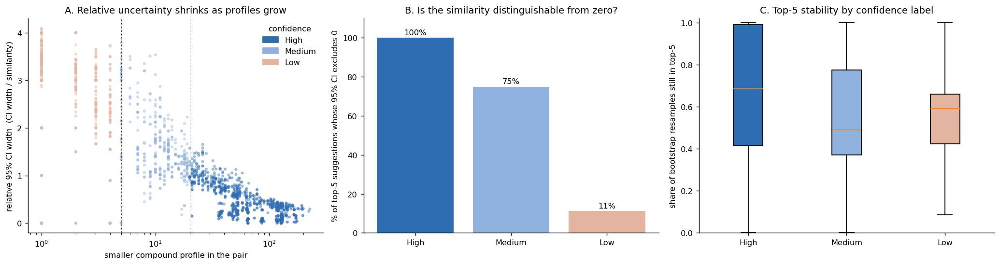
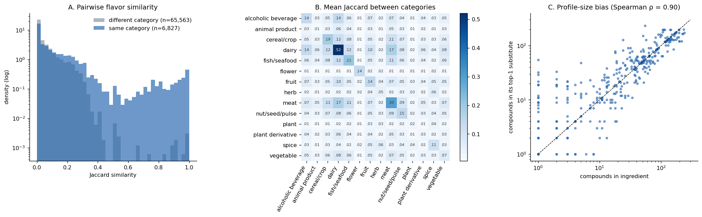
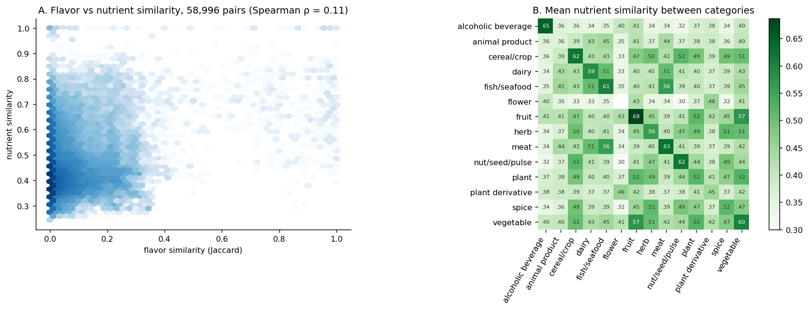
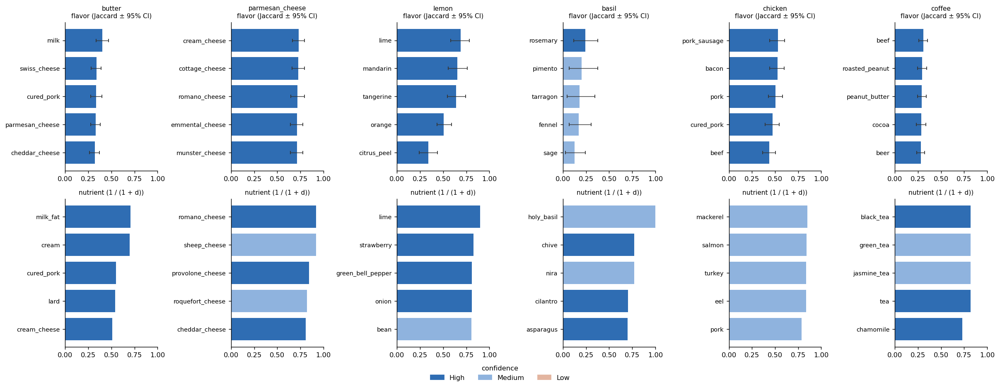

# Deliverable 2: Flavor- and Nutrient-Based Substitution Models

The system offers **two independent ways** to find a substitute, and the user chooses between them:

| Mode | Question it answers | Representation | Ingredients |
|---|---|---|---|
| **Flavor** | "What tastes chemically similar?" | set of flavor compounds (D1 Part A) | 381 |
| **Nutrient** | "What is nutritionally similar?", optionally lower or higher in chosen nutrients | 14 nutrients per 100 g from FooDB/USDA (D1 Part B) | 344 recipe ingredients, or **808 foods** in the extended catalog |

**Code:**
- `src/substitution_model.py`: both models
- `src/d2_substitution_model.py`: all results and figures (`python3 src/d2_substitution_model.py`, about 15 s)
- `src/recommend.py`: command-line tool

**Outputs:** `results/d2/`

```
python3 src/recommend.py butter                                          # flavor mode (default)
python3 src/recommend.py butter --mode nutrient
python3 src/recommend.py butter --mode nutrient --lower fat
python3 src/recommend.py beef   --mode nutrient --lower fat --higher protein
python3 src/recommend.py quinoa --mode nutrient                          # any of 808 FooDB foods
python3 src/recommend.py butter --mode nutrient --catalog recipe         # suggest recipe ingredients only
python3 src/recommend.py lemon  --min-confidence High --same-category
```

---

## 1. Flavor mode

### 1.1 Model

**Primary model: Jaccard similarity**

  J(a, b) = |C_a ∩ C_b| / |C_a ∪ C_b|

C_a is the set of flavor compounds in ingredient *a*. For a query ingredient, all other recipe ingredients are ranked by J.

**Variant: IDF-weighted Jaccard.** Each compound gets weight w_c = log(N / df_c), where df_c is the number of ingredients containing it. Sharing a rare compound then counts for more than sharing a ubiquitous one, such as 1-octanol, which occurs in 299 ingredients.

### 1.2 Uncertainty: confidence intervals instead of a cutoff

D1 showed that 81 recipe ingredients have fewer than 5 known compounds. Excluding them would have removed olive oil, lemon juice, oregano and scallion. Instead, **all 381 ingredients are scored**, and each recommendation reports how much the data can support it. There are three complementary measures:

| Measure | How it is computed | What it tells you |
|---|---|---|
| **95% confidence interval** | Bootstrap. Resample the 1,021 compounds with replacement 200 times, recompute J each time, and take the 2.5th and 97.5th percentiles. | How much the score depends on which compounds happen to be in the database. |
| **Top-5 stability** | Share of the 200 resamples in which the substitute is still in the query's top 5. | Whether the *rank* is robust, not just the score. |
| **Confidence label** | **High**: both ingredients have ≥ 20 compounds. **Medium**: both have ≥ 5. **Low**: otherwise. | A quick, interpretable summary. |

If resampling leaves a pair with no compounds at all, its similarity counts as 0 (no evidence) rather than being dropped. Otherwise identical singleton profiles, such as chickpea = octopus, would get a falsely narrow CI of [1, 1].



**Do the labels mean something?** Yes, once uncertainty is measured *relative* to the similarity value. The table covers top-5 suggestions:

| Label | Share of top-5 | Median similarity | Median relative CI width (CI width ÷ similarity) | CI excludes 0 |
|---|---|---|---|---|
| High | 55.7% | 0.37 | 0.38 | **100%** |
| Medium | 19.7% | 0.19 | 1.43 | 75% |
| Low | 24.6% | 0.09 | 3.0 | **11%** |

So **89% of Low-confidence suggestions are statistically indistinguishable from zero similarity**. For example, oregano (2 compounds) → black sesame seed has J = 0.05 with 95% CI [0, 0.18]. Every High suggestion is clearly above zero. In terms of *absolute* CI width, Low pairs look narrower than Medium (0.23 against 0.28), but only because their scores sit close to 0. This is why the relative width is the right measure.

**A caveat on stability (panel C).** Top-5 stability does *not* increase monotonically: the medians are High 0.69, Medium 0.49 and Low 0.59. Ingredients with tiny profiles overlap with only a few candidates at all, so their rankings are "locked in" even though they mean little. They are stable but uninformative. D2's earlier version found the same thing using a different perturbation test, which deleted 20% of links. **Confidence measures data uncertainty, not culinary validity.** Vanilla → mushrooms is labelled *High*, with a CI well above zero, yet it is a poor substitute. Judging validity is the job of D3.

### 1.3 Results



- **Most pairs are not similar.** Across 72,390 pairs, 43% share no compound, the median J is 0.015 and the 95th percentile is 0.23.
- **Category structure emerges without supervision** (panels A and B). The model never sees ingredient categories, yet same-category pairs average J = 0.133 against 0.049 for different-category pairs, 2.7× higher. Dairy (0.52), meat (0.30) and fish (0.21) are chemically coherent. **Herbs are not** (0.048), because each herb has its own small set of terpenes.
- **Profile-size bias** (panel C, Spearman ρ = 0.90). The union in the Jaccard denominator penalises size mismatch, so ingredients get matched with others whose profiles are about the same size. Profile size partly reflects how much an ingredient has been studied.
- **Top-1 substitute is in the same category for 66.4% of ingredients** (57.0% for the top 5). The top-1 CI excludes zero for 75.9% of ingredients.

**Where flavor mode works** (all High confidence, CIs well above 0):
- lemon → lime, mandarin, tangerine, orange
- parmesan → cream cheese, cottage cheese, romano, emmental
- onion → leek, chive, garlic, shallot
- white wine → red wine, cabernet, port
- butter → milk, Swiss cheese, parmesan

**Where it fails, there are three systematic patterns**, which become hypotheses for D3:
1. **Shared processing chemistry.** Coffee → beef, roasted peanut, cocoa, beer. They share roasting (Maillard) pyrazines and thiazoles, so the model is matching how foods were *cooked*, not their culinary role.
2. **Generic volatiles.** Vanilla → five mushrooms (J ≈ 0.20). These share 1-octen-3-ol and fatty acids, but not vanillin.
3. **Sparse profiles.** Chickpea (1 compound) → octopus (J = 1.0, CI [0, 1], Low). This is now clearly flagged rather than hidden.

**Jaccard vs IDF weighting.** The two are almost interchangeable: Spearman correlation 0.998 over all pairs and 88.7% top-5 overlap. IDF weighting does not fix the vanilla case.

---

## 2. Nutrient mode

### 2.1 Model

Each ingredient is described by a vector of 14 nutrients per 100 g: energy, protein, fat, carbohydrate, fibre, sugars, alcohol, cholesterol, sodium, potassium, calcium, iron, phosphorus and zinc. Nutrient values are heavily skewed (sodium ranges from 0 to 5,637 mg for soy sauce), so each feature is **log1p-transformed and z-scored**. Two ingredients are compared by the root-mean-square difference

  d(a, b) = sqrt( mean_f (z_af − z_bf)² ),  and nutrient similarity = 1 / (1 + d).

**Goals.** `--lower fat`, `--higher protein`, `--lower sodium sugar` and similar options keep only candidates that are at least 10% lower or higher than the query in those nutrients. Among those, candidates are still ranked by overall nutritional similarity, so the substitute stays as close as possible on everything else.

**Feature sets.** The default `--features full` uses all 14 nutrients. `--features macro` uses only energy and macronutrients. The choice matters: the two sets share only **47%** of their top-5 picks.

**Confidence label**, based on data quality:
- **High:** both ingredients are matched directly with nothing imputed.
- **Medium:** a proxy match, or at most 2 imputed values.
- **Low:** otherwise.

Every nutrient suggestion also shows its **flavor similarity**, so the user can check how close the taste is.

### 2.2 Results

- **344 ingredients** can be queried. That includes **67 of the 81** that flavor mode can only score with Low confidence, such as olive oil, lemon juice, oregano and chicken broth.
- **The top-1 substitute is in the same category for 81.7%** of ingredients (70.8% for the top 5). Nutrition tracks food categories more closely than chemistry does. Fruit (0.69), alcoholic beverages (0.65) and meat (0.63) are the most internally similar categories.
- **Confidence of top-5 suggestions:** 49.5% High, 49.0% Medium, 1.6% Low.

**Example recommendations:**

| Query | Nutrient top-3 | Flavor similarity of #1 |
|---|---|---|
| butter | milk fat (ghee), cream, cured pork | 0.02 |
| parmesan | romano, sheep cheese, provolone | 0.72 |
| olive oil | soybean oil, vegetable oil, coconut oil | 0.00 |
| rice | corn grits, macaroni, brown rice | 0.00 |
| honey | strawberry jam, maple syrup, grape | 0.01 |
| milk | yogurt, buttermilk, sour milk | 0.19 |
| chicken | mackerel, salmon, turkey | 0.25 |

**Goal-based examples** (`results/d2/goal_examples.csv`):

| Query and goal | Top suggestions |
|---|---|
| butter, *lower fat* | cream (37 g fat), cream cheese (34 g), emmental (28 g) |
| beef, *lower fat + higher protein* | roasted pork (27 g protein / 15 g fat), veal (19 / 7), chicken liver |
| cheddar, *lower sodium + lower fat* | **goat cheese** (368 mg Na, 21 g fat, *flavor similarity 0.83*), egg, herring |
| bacon, *lower sodium* | pork sausage, pork, chicken |
| rice, *higher fibre* | corn grits, macaroni, **brown rice** (flavor similarity 0.95) |

**Weaknesses.** Nutrient similarity knows nothing about culinary role:
- lemon → strawberry, green bell pepper, onion, because watery low-calorie produce all looks alike nutritionally;
- white bread with *higher protein + fibre* → saffron.

Using `--same-category`, or reading the flavor-similarity column, avoids most of these. Also, **8.3% of top-5 slots** are flagged `identical_record`: two ingredients mapped to the same FooDB record (e.g. the brewed teas, or the distilled spirits), so nutrition cannot tell them apart.

**Feature weighting.** All 14 nutrients count equally. As a check, we compared weightings by how often the top suggestion is in the same food group. This was measured on raw nearest neighbours, before the variant and generic filters, so the numbers differ slightly from §2.2:

| Weighting | Recipe ingredients | All 808 foods |
|---|---|---|
| **equal (default)** | **82.6%** | **75.9%** |
| macronutrients ×2 | 78.8% | 74.8% |
| macronutrients ×3 | 77.6% | 74.4% |
| macronutrients only | 72.7% | 70.8% |

Equal weighting does best, so it is the default. It can fail for foods with an unusual mineral content. Calcium-set tofu (517 mg Ca per 100 g) is matched to calcium-rich leafy greens such as moringa and jute. With `--features macro`, its top match is cottage cheese. For "similar protein or energy source" questions, macro features are the better choice.

### 2.3 Extended catalog: any of 808 foods (`--catalog all`, the command-line default)

Nutrient similarity does not need recipe or flavor data, so the nutrient model also runs over the **808-food FooDB catalog** (D1 §6.5): the 344 recipe ingredients plus 464 further foods. Any food in the catalog can be queried, and any can be suggested.

| | Recipe catalog (344) | Extended catalog (808) |
|---|---|---|
| Top-1 in the same food group | 81.7% (recipe categories) | 72.9% (FooDB food groups) |
| Top-5 in the same food group | 70.8% | 67.1% |
| Top-5 confidence: High / Medium / Low | 49.5 / 49.0 / 1.6% | 12.3 / 53.5 / 34.2% |

For queries about recipe ingredients, **36.9% of the top-5 suggestions now come from outside the recipe dataset**. For example, butter's list adds margarine, and salmon's list adds Spanish mackerel and croaker.

Examples for foods that appear in no recipe:

| Query | Top suggestions |
|---|---|
| quinoa | buckwheat, sorghum, rye flour, millet, wheat |
| rabbit | goat, quail, deer, beefalo |
| jackfruit | concord grape, cherry, fig, grape |
| turbot | Atlantic croaker, cisco, striped bass, Pacific rockfish |
| breadfruit | guava, custard apple, European chestnut, sugar-apple |

Confidence is lower here because auto-added foods have unreviewed, aggregated profiles and are capped at Medium. These suggestions also **cannot be validated in D3**, because these foods appear in no recipe. For that reason, all D2 statistics in §2.2 and §3, and all of D3, use the recipe catalog. 37 regional specialty foods (bowhead whale, beluga, cloudberry) can be queried but are not suggested by default (`--include-specialty`).

---

## 3. Flavor vs nutrient: two different notions of "similar"





Across the 58,996 ingredient pairs that both modes can score:
- **The two similarities are almost unrelated:** Spearman ρ = **0.11** (panel A).
- The modes' top-5 lists **overlap by only 16%** on average, and **51%** of ingredients have no substitute in common between the two lists.
- The nutrient top-1 has a mean flavor similarity of only 0.27, against 0.49 for the flavor top-1.

The modes agree mainly where an ingredient's category determines both taste and nutrition: cheeses (parmesan → romano), citrus (lemon → lime) and brown/white rice. Elsewhere they give very different answers. Butter's flavor neighbours are dairy products, which share its compounds. Its nutrient neighbours are other fats: ghee, lard, cured pork.

**Implication:** chemical flavor similarity alone cannot deliver nutritionally equivalent swaps, and nutritional similarity alone cannot deliver tasty ones. That is why the system offers both modes and shows the other mode's score as a cross-check. D3 will test which mode better predicts substitutions that real cooks make.

---

## 4. Design decisions (both modes)

| Decision | Choice | Reason |
|---|---|---|
| Candidate pool | recipe ingredients only | Every suggestion can be validated against recipes and real substitution data in D3. |
| Same ingredient in another form | excluded, and repeats collapsed | Prevents trivial suggestions like beef → raw_beef → roasted_beef. The rule matches only names that are identical after removing form words. |
| Generic catch-all terms (`meat`, `cheese`, `berry`, `fish`, `nut`, …, 21 terms) | can be queried, never suggested | They were "hub" substitutes (`berry` appeared in 22 top-5 lists), and in nutrient mode beef → "meat" scored 1.0. |
| More-specific names (cheese → parmesan) | kept, flagged `name_nested` | They are real substitutes, just "easy" ones (about 4–5% of top-5 slots). |
| Ties | alphabetical | Reproducibility. |

## 5. Summary

- **Flavor mode** recovers real culinary structure from chemistry alone, and every suggestion carries a 95% CI and a confidence label. 89% of Low-confidence suggestions cannot be distinguished from zero similarity, which makes clear when the chemistry simply isn't known. It has three systematic failure modes: processing chemistry, generic volatiles and profile-size bias.
- **Nutrient mode** covers 344 recipe ingredients (including the chemically sparse ones) and **808 foods** in the extended FooDB catalog. It supports goals such as lower fat or higher protein, and tracks food categories closely (82% same-category top-1). However, it is blind to culinary role.
- **The two notions of similarity are nearly independent** (ρ = 0.11). This is a central result for the final analysis.
- **Next (D3):** validate both modes against recipe co-occurrence and against real substitution pairs (Recipe1MSubs), and report precision for each confidence level.
