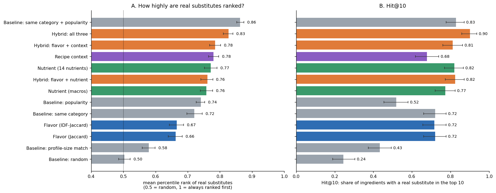
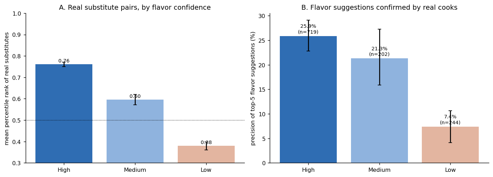
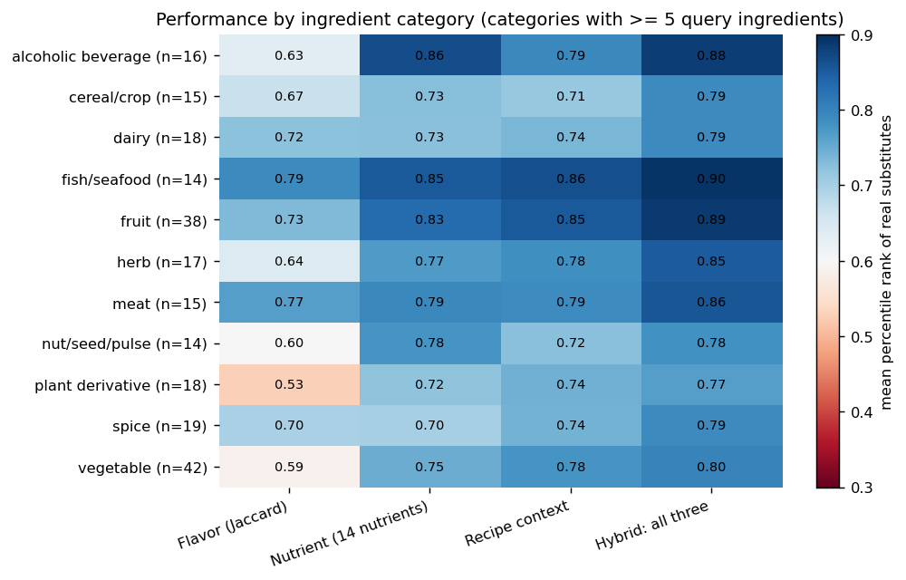
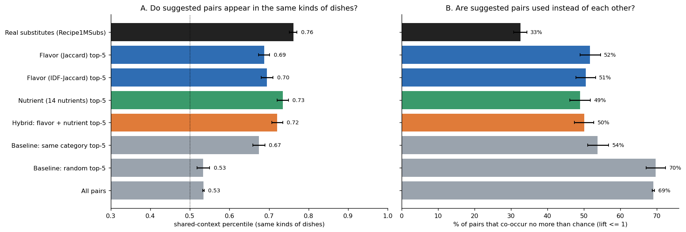

# Deliverable 3: Recommendation Evaluation

**Question:** do the substitutes suggested by flavor-compound similarity, and by the nutrient model, match substitutions that real cooks make? And do they behave like substitutes in real recipes?

**Code:**
- `src/d3_evaluation.py` (`python3 src/d3_evaluation.py`, about 15 s, deterministic with seed 0)
- `src/recipe1m_mapping.py`: name mapping
- `src/safe_pickle.py`: restricted data loader

**Outputs:** `results/d3/`

## 1. Evidence used

### A. Ground truth: real substitutions (Recipe1MSubs)

Recipe1MSubs (Fatemi et al., 2023, *"Learning to Substitute Ingredients in Recipes"*) contains substitutions that users reported in comments on Recipe1M recipes, such as *"I used olive oil instead of butter"*. We used the training split: **49,044 substitution records, 23,421 distinct pairs**. This data is completely independent of our models, which were never fitted to it.

**Safety.** The files are Python pickles. Before loading, we inspected their opcodes statically: they contain no class or function references, only dicts, lists, tuples and strings. They were then loaded with a restricted unpickler that refuses every class (`src/safe_pickle.py`).

**Name mapping** (`src/recipe1m_mapping.py`). Recipe1M names ("lean_ground_beef", "fresh_garlic_cloves") were mapped onto our ingredient names using three steps:
1. remove modifier words (fresh, lean, chopped, unsalted, …);
2. remove part words (breast, cloves, leaves, …);
3. apply a curated synonym table (flour → wheat, green onion → scallion, spaghetti → macaroni, …).

**Precision was preferred over recall.** Ambiguous names such as egg white, sour cream, coconut milk and onion powder are left unmapped, not guessed. The mapping covers 53% of all name mentions. The unmapped ones are mostly ingredients outside our dataset: water, sugar, sour cream, margarine.

| | |
|---|---|
| Records whose two ingredients both map to our names (forms of the same ingredient removed) | 14,092 |
| Distinct directed pairs | 2,916 |
| **In the evaluation pool:** pairs / records / query ingredients | **2,714 / 13,719 / 233** |

Examples of the most frequent pairs: butter → olive oil (428), beef → turkey (341), cream → milk (279), walnut → pecan (279), lemon juice → lime juice (164), parsley → cilantro (153).

### B. Recipe co-occurrence (the 56,144 flavor-network recipes)

Two recipe-based properties were tested:
- **Shared context:** do two ingredients appear in the same kinds of dishes? This is the cosine similarity of their PPMI co-occurrence vectors, with the pair's own entries removed so that co-occurring with *each other* does not count. It is expressed as a within-query percentile, where 0.5 is random.
- **Exclusivity:** do they co-occur no more than chance? This is lift = observed / expected co-occurrence, with lift ≤ 1 counting as exclusive.

### Evaluation set-up

- **Common candidate pool:** 331 recipe ingredients that have both flavor and nutrient data, excluding generic terms. Every method ranks exactly the same candidates.
- **Fair comparison:** forms of the query (beef → roasted_beef) never count, and tied scores get average ranks.
- **Metrics:**
  - **mean percentile rank** of the real substitutes (0.5 = random, 1 = always ranked first). This is threshold-free, and is our headline metric;
  - Hit@k (at least one real substitute in the top k), Precision@5, Recall@10 and MRR.
- **Uncertainty:** all intervals are 95% bootstrap CIs over queries (1,000 resamples), and method comparisons use paired bootstraps.
- **The ground truth is incomplete.** A suggestion that is absent from Recipe1MSubs is not necessarily wrong, so precision is a *lower bound*.

**Methods compared:**
- flavor: Jaccard, and IDF-weighted Jaccard;
- nutrient: 14 nutrients, and macronutrients only;
- recipe context (shared-context similarity used as a recommender);
- three rank-average hybrids;
- five baselines:
  - **random**;
  - **same category**: any ingredient from the query's category;
  - **popularity**: the most frequently used recipe ingredients;
  - **profile-size match**: rank by similarity of compound-profile size, which tests whether flavor's signal is only the size bias found in D2;
  - **same category + popularity**: a strong, "common-sense" baseline.

## 2. Results against real substitutions

| Method | Mean percentile [95% CI] | MRR | Hit@1 | Hit@5 | Hit@10 | P@5 | R@10 |
|---|---|---|---|---|---|---|---|
| Baseline: random | 0.50 [0.49, 0.52] | 0.13 | 5.6% | 18.0% | 24.5% | 3.9% | 2.6% |
| Baseline: profile-size match | 0.58 | 0.17 | 7.3% | 30.5% | 43.3% | 7.7% | 6.8% |
| **Flavor (Jaccard)** | **0.66 [0.64, 0.68]** | 0.45 | 33.0% | 58.8% | 72.1% | 21.2% | 20.5% |
| Flavor (IDF-Jaccard) | 0.67 | 0.45 | 33.5% | 62.7% | 71.7% | 21.7% | 20.5% |
| Baseline: same category | 0.72 | 0.37 | 20.6% | 56.2% | 72.1% | 19.3% | 20.4% |
| Baseline: popularity | 0.74 | 0.19 | 6.4% | 37.3% | 51.9% | 12.8% | 9.7% |
| Nutrient (macros) | 0.76 | 0.38 | 24.0% | 60.9% | 77.3% | 20.2% | 25.7% |
| Hybrid: flavor + nutrient | 0.76 | 0.49 | 34.8% | 66.1% | 82.4% | 24.5% | 25.8% |
| **Nutrient (14 nutrients)** | **0.77 [0.75, 0.79]** | 0.46 | 29.2% | 69.1% | 82.0% | 24.8% | 27.4% |
| Recipe context | 0.78 | 0.45 | 32.6% | 60.5% | 67.8% | 25.3% | 18.2% |
| Hybrid: flavor + context | 0.79 | 0.54 | 42.5% | 68.2% | 81.1% | 28.6% | 24.9% |
| **Hybrid: all three** | **0.83 [0.81, 0.84]** | **0.61** | **47.2%** | **79.0%** | **90.1%** | 34.4% | 32.8% |
| Baseline: same category + popularity | **0.86** [0.85, 0.88] | 0.56 | 45.5% | 71.2% | 82.8% | 34.8% | 33.3% |

**Paired differences in mean percentile** (95% CI):

| Comparison | Difference | Conclusion |
|---|---|---|
| Flavor − random | **+0.16** [0.13, 0.19] | Hit@10 +48 points. Clearly better than chance. |
| Flavor − profile-size match | **+0.08** [0.06, 0.11] | The signal is **not just the size bias** from D2. |
| Flavor − same category | **−0.06** [−0.08, −0.03] | Hit@10 identical (0.00 [−0.07, 0.07]). Flavor alone does **not** beat "pick something from the same category". |
| Flavor − nutrient | −0.11 [−0.13, −0.09] | Nutrient similarity predicts real substitutions better. |
| Flavor − IDF-Jaccard | −0.003 [−0.005, −0.002] | Statistically detectable but negligible, so D2's finding holds. |
| Hybrid (all three) − flavor | **+0.17** [0.15, 0.18] | Combining the evidence helps a lot. |

**Robustness.** Using only pairs that were reported at least twice gives the same ranking: flavor 0.68, nutrient 0.84, hybrid 0.88, same category + popularity 0.91.

**The strongest baseline.** "Same category + popularity" has the best mean percentile. Real cooks mostly substitute **common ingredients from the same category**: olive oil for butter, milk for cream, turkey for beef. They use what is in their kitchen. The full hybrid still beats this baseline where it matters for a recommender, at the top of the list: Hit@1 47% vs 46%, Hit@5 79% vs 71%, Hit@10 90% vs 83%, MRR 0.61 vs 0.56.

### 2.1 Does chemistry add information beyond category?

Flavor did not beat the category baseline, so we tested whether chemical similarity carries **any independent information**. We ran two tests.

**(1) Logistic regression** on all 76,842 query–candidate pairs (2,714 of them real substitutes), with standardized predictors. CIs come from a bootstrap over queries:

| Predictor | Coefficient [95% CI] |
|---|---|
| popularity of the candidate | +1.20 [1.12, 1.27] |
| recipe-context similarity | +0.57 [0.51, 0.63] |
| nutrient similarity | +0.37 [0.29, 0.45] |
| same category | +0.37 [0.30, 0.42] |
| **flavor (Jaccard) similarity** | **+0.21 [0.16, 0.26]** |
| profile-size match | −0.06 [−0.14, 0.04] (not significant) |

Flavor similarity stays a significant positive predictor **after controlling for category, nutrition, recipe context, popularity and profile size**. Chemistry contributes real, but modest, independent information. Profile-size match contributes nothing once the other predictors are included.

**(2) Ranking within the same category only.** Restricting each query to candidates from its own category (209 queries), the mean percentile of real substitutes is:
- flavor **0.60** [0.58, 0.62]
- nutrient 0.65
- recipe context 0.70
- random 0.50

So flavor *does* help choose *among* same-category options, just less than the other two signals.

### 2.2 Are the confidence labels from D2 meaningful?

This is a clean validation of the confidence design from D2:

| Flavor confidence of the pair | Mean percentile of real substitutes | Precision of top-5 flavor suggestions |
|---|---|---|
| High (both ≥ 20 compounds) | **0.76** [0.75, 0.77], n = 1,511 | **25.9%** [22.8, 29.1], n = 719 |
| Medium (both ≥ 5) | 0.60 [0.57, 0.62], n = 500 | 21.3% [15.8, 27.2], n = 202 |
| Low | **0.38** [0.36, 0.40], n = 703 | **7.4%** [4.1, 10.7], n = 244 |

- **When both profiles are rich, flavor similarity works:** a percentile of 0.76 for High pairs is on par with the nutrient model overall.
- **When a profile is sparse, it is worse than random (0.38).** For a sparse ingredient, the real substitutes tend to share none of its few known compounds.
- **Low-confidence suggestions are confirmed by real cooks only a third as often as High ones** (7% vs 26%).

The labels reliably separate suggestions you can trust from ones you cannot. This supports the decision to keep all ingredients but flag uncertainty, rather than hide them.

### 2.3 Where each model works

- **Flavor works best for animal foods and fruit:** fish/seafood 0.79, meat 0.77, fruit 0.73, dairy 0.72. These are categories whose aromas come from shared biochemistry, such as lipid oxidation in fish and meat, or esters in fruit.
- **It is near random for "plant derivatives" (0.53):** oils, vinegar, soy sauce, cocoa. Most have very sparse profiles, and their real substitutes are chosen for *function* (fat, acid) rather than aroma.
- **It is weak for vegetables (0.59) and nuts (0.60).**
- **Nutrient similarity wins for alcoholic beverages (0.86 vs 0.63) and nuts (0.78).**
- The full hybrid is the best or tied-best model in every category.

**Examples** (`results/d3/examples.csv`; \* = confirmed by real cooks):

| Ingredient | Real substitutes (count) | Flavor top-5 | Nutrient top-5 |
|---|---|---|---|
| onion | scallion (196), shallot (192), leek (49), garlic, chive | **\*leek, \*chive, \*garlic, \*shallot**, \*cabbage | strawberry, strawberry juice, nectarine, \*cranberry, lingonberry |
| walnut | pecan (279), almond (72), raisin, cashew, hazelnut | \*pistachio, \*hazelnut, roasted hazelnut, \*cashew, \*macadamia | **\*pecan, \*almond**, roasted peanut, \*pistachio, roasted hazelnut |
| beef | turkey (341), pork sausage (115), chicken (105), pork | \*bacon, \*pork sausage, roasted pork, \*pork, cured pork | \*lamb, mutton, \*pork, roasted pork, \*veal |
| butter | olive oil (428), vegetable oil (152), coconut oil (118), milk | \*milk, swiss cheese, cured pork, parmesan, \*cheddar | milk fat, \*cream, cured pork, \*lard, \*cream cheese |
| lemon juice (3 compounds, Low) | lime juice (164), vinegar (39), orange juice (29) | tarragon, mandarin peel, sesame seed, marjoram, … | **\*lime juice**, cucumber, watermelon, … |
| white wine | chicken broth (106), vinegar, sherry, milk, sake | \*red wine, cabernet, port, champagne, wine | champagne, \*cider, wine, \*red wine, \*sherry |

The examples show both sides:
- **Where flavor shines:** onion gives four real substitutes out of four plausible suggestions.
- **Functional swaps it cannot see:** butter → olive oil (fat), white wine → chicken broth (cooking liquid).
- **The sparse-profile failure:** lemon juice, which carries a Low label.

## 3. Results against recipe co-occurrence

| Pairs (both ingredients in ≥ 20 recipes) | Shared-context percentile | Exclusive (lift ≤ 1) | Never together | Median lift |
|---|---|---|---|---|
| **Real substitutes (Recipe1MSubs)** | **0.76** [0.75, 0.77] | 33% | 2% | 1.48 |
| Flavor (Jaccard) top-5 | 0.69 [0.67, 0.70] | 52% | 29% | 0.93 |
| Flavor (IDF) top-5 | 0.70 | 51% | 29% | 0.97 |
| Nutrient top-5 | 0.73 [0.72, 0.75] | 49% | 25% | 1.05 |
| Hybrid flavor + nutrient top-5 | 0.72 | 50% | 24% | 0.99 |
| Baseline: same category top-5 | 0.67 | 54% | 28% | 0.85 |
| Baseline: random top-5 | 0.53 | 70% | 39% | 0.34 |

1. **Flavor-suggested pairs appear in the same kinds of dishes** much more than random pairs (0.69 vs 0.53), and slightly more than same-category pairs (0.67). By this measure, recipe co-occurrence **supports** chemically derived substitutes.
2. **Exclusivity does not hold.** We expected real substitutes to *avoid* each other in recipes, since you use one or the other. Recipe1MSubs refutes this: 67% of real substitute pairs co-occur *more* than chance (median lift 1.48), and only 2% never appear together. Real substitutes are often used side by side: onion and shallot, walnut and pecan, parsley and cilantro. **Shared context is a valid signal of substitutability, but exclusivity is not.** Low co-occurrence should therefore not be used to validate substitutes.
3. **Chemistry and recipe context are almost unrelated overall.** Across all pairs, Spearman ρ(Jaccard, context similarity) = **0.02**; within the same category it is 0.13. Chemical similarity says little about *which dishes* an ingredient is used in, which is consistent with D2's finding that flavor and nutrition are independent.
4. **Cuisine bias check.** The recipes are 74% North American, so we recomputed context similarity separately for North American recipes (41,263) and for all other cuisines (14,881). Flavor top-5 pairs score 0.71 in both, and real substitutes score 0.78 and 0.76. The conclusions do not depend on the North American majority.

## 4. Summary

| Hypothesis or question | Verdict |
|---|---|
| Flavor-compound similarity predicts real substitutions better than chance | **Yes**: percentile 0.66 vs 0.50, Hit@10 72% vs 25% |
| …and this is not just the profile-size artefact | **Yes**: +0.08 over the size-only baseline; size is not significant in the regression |
| …and better than simply staying within the category | **No**: −0.06, Hit@10 equal |
| Chemistry adds information beyond category, nutrition, context and popularity | **Yes, modestly**: logistic coefficient +0.21 [0.16, 0.26]; within-category percentile 0.60 |
| D2's confidence labels identify trustworthy suggestions | **Yes, strongly**: High 0.76 / Medium 0.60 / Low 0.38; precision 26% / 21% / 7% |
| IDF weighting improves Jaccard | **No** (negligible) |
| Nutrient similarity predicts real substitutions | **Yes**: 0.77, Hit@10 82%, better than flavor |
| Flavor-suggested pairs appear in the same kinds of dishes | **Yes**: 0.69 vs 0.53 random |
| Real substitutes avoid co-occurring | **No**: median lift 1.48 |
| Combining flavor + nutrient + recipe context is the best model | **Yes**: 0.83, Hit@10 90%, MRR 0.61 |

**Limitations**
- **Ground truth:**
  - only the training split of Recipe1MSubs was used (val and test can be added by dropping the files into `data/raw/recipe1msubs/`);
  - the name mapping is conservative and covers 53% of mentions;
  - the substitution comments come from North American home cooks, which favours common pantry swaps (hence the strength of the popularity baseline).
- **Unmeasured substitutes:** substitutes that are absent from the ground truth count as misses, so all precision figures are lower bounds.
- **Extended catalog not evaluated:** the 464 FooDB foods outside the recipe data cannot be evaluated.
