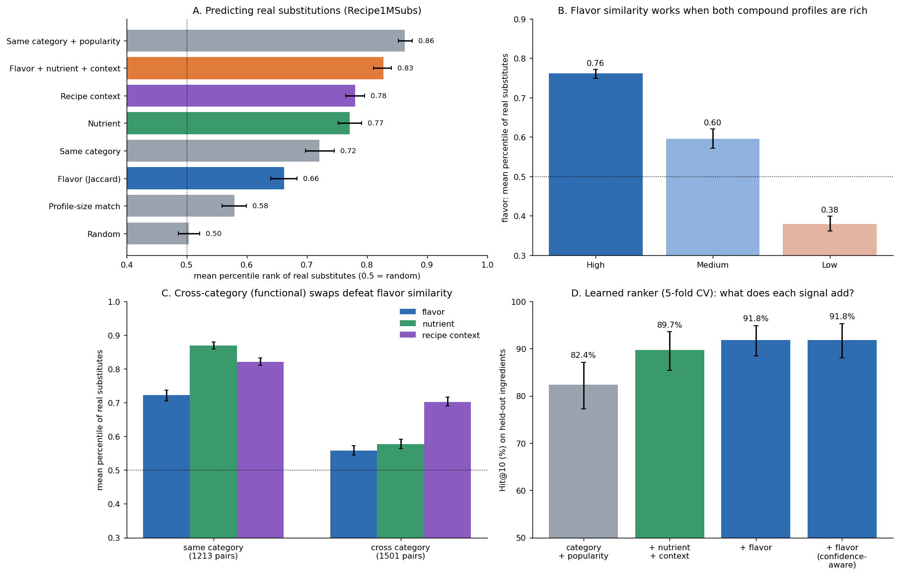

# Deliverable 4: Result Analysis and Conclusion

**Research question:** *Can chemical flavor similarity predict plausible ingredient substitutions?*

**Code:**
- `src/d4_analysis.py` (ablation, learned ranker, error analysis)
- builds on the D3 set-up (`src/d3_evaluation.py`)

**Outputs:** `results/d4/`

---

## 1. What was built

| Deliverable | Result |
|---|---|
| **D1: Data pipeline** | Flavor Network data (Ahn et al., 2011), verified 100% against the paper's published network. It yields a 1,525 × 1,107 ingredient–compound matrix (381 ingredients used in 56,144 recipes). From FooDB, a hand-matched 14-nutrient profile for 344 recipe ingredients, plus an extended catalog of 808 foods. |
| **D2: Substitution model** | Two user-selectable modes. **Flavor**: Jaccard similarity of compound sets, with a 95% bootstrap CI, top-5 stability and a High/Medium/Low confidence label on every suggestion. **Nutrient**: distance between standardized nutrient profiles, with goals such as *lower fat* or *higher protein*. Command-line tool: `src/recommend.py`. |
| **D3: Evaluation** | Tested against 2,714 real substitution pairs reported by cooks (Recipe1MSubs) and against co-occurrence patterns in the 56k recipes, with five baselines and bootstrap CIs. |
| **D4: Analysis** | Ablation (does flavor add value to other signals?), a cross-validated learned ranker, and an error analysis of what flavor misses. |

*Panel D's y-axis starts at 50%.*

---

## 2. Main findings

### Finding 1: Flavor similarity predicts real substitutions far better than chance, but not better than "stay in the same category"

- **Against chance.** Real substitutes are ranked at the **66th percentile** by Jaccard flavor similarity, against 50 for random. A real substitute is in the top 10 for **72%** of ingredients, against 25% for random.
- **Not a size artefact.** The signal does not come from the profile-size bias found in D2: it is +0.08 over a size-only baseline, and size is not significant in the regression.
- **Against category.** Flavor alone does *not* beat "pick an ingredient from the same category" (0.72 percentile, same Hit@10). Most of what chemistry "knows" is which family a food belongs to. Animal products, fruit and dairy each have a recognisable chemical signature, and D2 showed that the model rediscovers these categories without being told them.

### Finding 2: Chemistry carries real, but modest, independent information

- **In a logistic regression** over 76,842 query–candidate pairs, flavor similarity remains a significant predictor (standardized coefficient **+0.21** [0.16, 0.26]). This holds *after* controlling for category, nutrition, recipe context, candidate popularity and profile size.
- **Within the same category**, flavor still ranks real substitutes above chance (0.60 [0.58, 0.62]).
- **In a learned ranker evaluated on held-out ingredients** (5-fold cross-validation over queries), adding flavor to category, popularity, nutrition and context improves:
  - **Hit@10 from 89.7% to 91.8%** (+2.1 points [+0.4, +4.3], significant);
  - Hit@1 by +1.3 points and MRR by +0.013 (both not significant).
- **In a simple rank-average hybrid**, adding flavor to nutrient + context changes Hit@10 by +3.0 points [−0.9, +6.9] (not significant).

The added value of chemistry is **statistically detectable but small**.

### Finding 3: Where flavor works, and where it fails, is predictable

**(a) Data richness.** The D2 confidence labels split performance cleanly:

| Flavor confidence | Real-substitute percentile | Precision of top-5 suggestions |
|---|---|---|
| High (both ≥ 20 compounds) | **0.76** | **25.9%** |
| Medium | 0.60 | 21.3% |
| Low | **0.38** (*worse than random*) | 7.4% |

**(b) Same-category vs cross-category swaps.** 45% of distinct real substitute pairs (70% of reports) stay within a category. The rest are **functional** swaps:

| Swap type | Flavor | Flavor (High-confidence pairs only) | Nutrient | Recipe context |
|---|---|---|---|---|
| Same category (1,213 pairs) | 0.72 | **0.86** | **0.87** | 0.82 |
| Cross category (1,501 pairs) | 0.56 | 0.68 | 0.58 | **0.70** |

**For same-category swaps between well-profiled ingredients, flavor similarity is as good as nutrition (0.86 vs 0.87).** Examples include onion → leek, shallot, chive, garlic; lemon → lime; walnut → hazelnut and pistachio; parmesan → romano.

Cross-category swaps replace an ingredient's *role* in the dish, and so defeat chemical similarity:

| Most frequent cross-category transitions | Reports | Example | Role being replaced | Flavor percentile |
|---|---|---|---|---|
| dairy → plant derivative | 782 | butter → olive oil (428), vegetable oil, coconut oil | fat | 0.40 |
| plant derivative → dairy | 252 | vegetable oil → butter | fat | 0.60 |
| alcoholic beverage → meat | 146 | white wine → chicken broth (106) | cooking liquid | 0.26 |
| plant derivative → fruit | 106 | vinegar → lemon juice | acid | 0.54 |
| animal product → plant derivative | 86 | honey → maple syrup (62) | sweetener | 0.31 |

Nutrient similarity captures some functional swaps (butter → oils, honey → maple syrup, both share a macronutrient). Recipe context captures more, because it sees that the ingredients fill the same slot in dishes. **None of the three signals handles functional substitution well.**

**(c) Category.** Flavor works best for fish/seafood (0.79), meat (0.77), fruit and dairy. It is near random for "plant derivatives" such as oils, vinegar and sauces (0.53), which have sparse profiles and are swapped for their function.

### Finding 4: Recipe co-occurrence supports flavor-based suggestions, but real substitutes are not "exclusive"

- **Shared context.** Flavor-suggested pairs appear in the same kinds of dishes much more than random pairs (context percentile 0.69 vs 0.53), slightly more than same-category pairs (0.67), and below real substitutes (0.76).
- **No exclusivity.** The common assumption that substitutes rarely appear together is **refuted**: real substitute pairs co-occur *more* than chance (median lift 1.48; only 2% never appear together). Validating substitutes by low co-occurrence would be a mistake. Shared context is the valid recipe signal.
- **Weak link between chemistry and dishes.** Across all pairs, chemical similarity is almost unrelated to recipe context (Spearman ρ = 0.02; 0.13 within a category).
- **No cuisine bias.** These results hold separately for North American and non-North-American recipes.

### Finding 5: Flavor and nutrition are independent notions of "similar"

Across 58,996 pairs, flavor and nutrient similarity correlate at ρ = 0.11, and the two modes' top-5 lists overlap by only 16%. Nutrient similarity predicts real substitutions better (0.77 vs 0.66, Hit@10 82% vs 72%), especially within a category (0.87). It is blind to culinary role (lemon → strawberry) and does not capture taste. This justifies offering the two modes separately, and showing the other mode's score as a cross-check.

---

## 3. Answer to the research question

> **Chemical flavor similarity can predict plausible substitutions, but only partially.** It recovers food categories without supervision and ranks real substitutes well above chance. When both ingredients are well characterised and the swap stays within a food family, it performs as well as nutritional similarity (percentile 0.86). It fails when compound data are sparse (worse than random) and for *functional* swaps, where an ingredient replaces another's role (fat, acid, liquid, sweetener) rather than its aroma. These make up over half of the distinct substitutions that cooks report. Combined with nutrition and recipe context, chemistry adds a small but statistically detectable gain (+2 points Hit@10 on held-out ingredients). On its own it does not beat simple category knowledge.

Put simply: shared flavor compounds explain **"what tastes alike"**, but cooks substitute on the basis of **"what does the same job"**. The two overlap within a food family and diverge across families.

## 4. Why this happens

1. **Binary compound sets ignore concentration and potency.** Jaccard treats a trace volatile the same as a key odorant. Vanilla → mushrooms matched on generic compounds (1-octen-3-ol, fatty acids), not vanillin. Real flavor perception is dominated by a few compounds above their odour threshold.
2. **Shared processing chemistry looks like shared identity.** Roasting and frying create the same Maillard pyrazines and thiazoles in coffee, beef, peanuts and cocoa. Chemistry links them, but cooking does not.
3. **Compound coverage reflects research attention.** Profile size ranges from 1 to 239 compounds, and Jaccard matches ingredients of similar profile size (ρ = 0.90). Sparse profiles are not "simple" flavors; they are understudied ones. That is why Low-confidence pairs perform worse than random.
4. **Substitution is functional and practical.** The strongest predictor of a real substitute is how *common* the candidate is (coefficient +1.20). Cooks reach for what is in the pantry, and they replace texture, fat, acidity or moisture as often as taste.

## 5. Practical recommendations for a substitution system

1. **Do not use flavor similarity alone.** Combine it with nutrition and recipe context. The rank-average hybrid reaches Hit@10 90% and MRR 0.61, and the learned ranker reaches Hit@10 92%.
2. **Always show uncertainty.** Hide or flag Low-confidence flavor suggestions: they are confirmed by cooks only 7% of the time, against 26% for High.
3. **Use flavor for within-family swaps**, such as citrus, alliums, cheeses, nuts, fish and meats. Use **nutrient mode** when the goal is dietary (*lower fat*, *higher protein*), and let the flavor score serve as a taste check.
4. **Recognise functional swaps explicitly.** A future system should model culinary role (fat, acid, liquid, sweetener, thickener) as a separate signal.

## 6. Limitations

| Area | Limitation |
|---|---|
| Flavor data | Binary presence only, with no concentrations or odour thresholds. Coverage is uneven (81 recipe ingredients have fewer than 5 compounds). The data come from a 2011 snapshot. |
| Nutrient data | 68 of the 344 recipe ingredients use proxy matches. The 464 auto-added FooDB foods are aggregated and unreviewed, and cannot be validated (they appear in no recipe). Values are raw, not as cooked. |
| Ground truth | Only the Recipe1MSubs training split. The name mapping is conservative (53% of mentions). Comments come mostly from North American home cooks, which favours pantry swaps. Unreported substitutes count as misses, so precision is a lower bound. |
| Recipes | 74% North American (although the results were robust when split by cuisine). Ingredient names are coarse (e.g. "cheese", "pepper"). |
| Evaluation | All results are at the level of ingredient pairs, not recipes. Whether a substitute works can depend on the dish, which this evaluation does not test. |

## 7. Future work

1. **Richer chemistry.** Use FlavorDB2 (936 ingredients, 25,595 molecules) and weight compounds by concentration × odour activity, or restrict to *key odorants*. This should reduce the generic-volatile and processing-chemistry errors.
2. **Functional-role features**, such as fat, acid, liquid, sweetener, binder or leavening, derived from nutrients or annotated, to handle cross-category swaps.
3. **Context-aware substitution:** score a substitute *within a specific recipe*, as GISMo does (Fatemi et al., 2023), rather than as a fixed pair.
4. **A larger and fairer ground truth:** add the Recipe1MSubs validation and test splits and non-Western sources, and run a small human taste or acceptability study for suggestions outside the ground truth.

## 8. Conclusion

This project built a reproducible pipeline that represents ingredients by their flavor compounds and nutrients. It recommends substitutes with quantified uncertainty, and validates them against both recipe co-occurrence and nearly 14,000 real substitutions reported by cooks.

The evidence supports a **qualified yes**. Chemical flavor similarity captures genuine culinary structure, and it is a strong predictor of within-family substitutions between well-characterised ingredients. As a general substitution engine, however, it is limited by sparse and binary compound data, and above all by the functional nature of many real substitutions. The most useful role for computational flavor chemistry in substitution is as **one well-calibrated signal among several**: combined with nutrition and recipe context, and always reported with its confidence.
